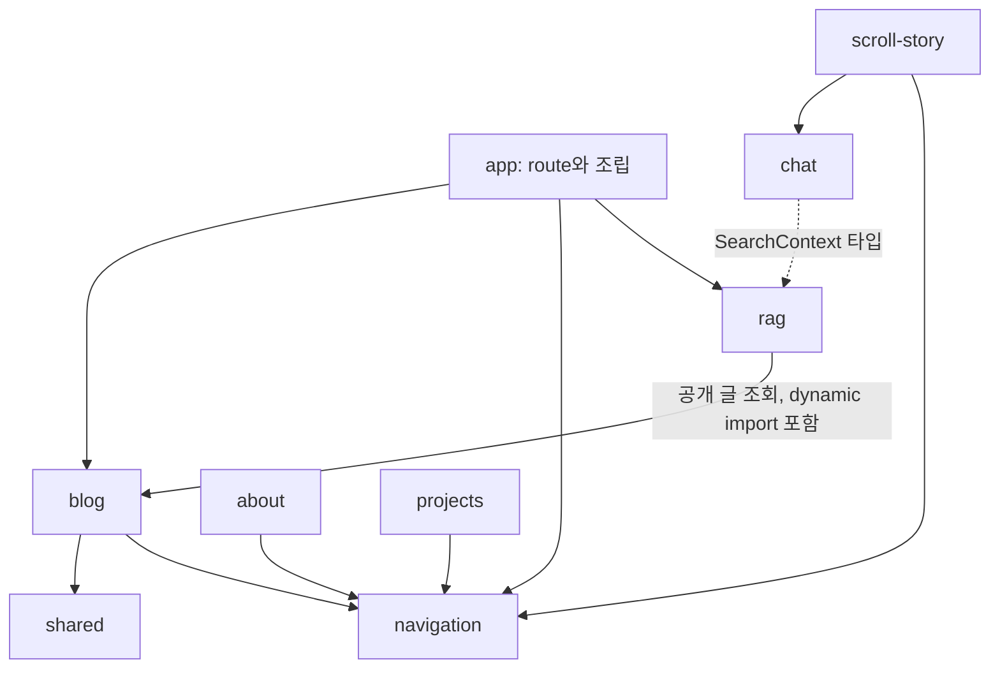

# Blog features 책임과 의존성

2026-11-09 작업본 기준. 사용자 요청으로 교체가 끝난 실험 페이지·픽셀룸·로컬 챗봇을 제거한 뒤의
구조다. 이번 문서는 리팩토링의 설계 기준이며 실행 증거는 별도 audit에 기록한다.

## 범위와 보존 조건

- Blog의 UI, React 상태, 순수 규칙, 서버 서비스, HTTP 경계를 구분한다.
- 정식 URL, 화면 디자인, 검색 결과와 순서, 콘텐츠 저장·발행 계약을 유지한다.
- `/experiments/*`와 픽셀룸은 이번 정리에서 제거했다. 복구하거나 redirect를 재추가하지 않는다.
- `/portfolio/preview`, `/portfolio/print`는 실험 라우트가 아닌 독립 출력 기능으로 유지한다.
- 새 패키지·의존성·BFF 서버를 추가하지 않는다. CMS·Worker·core 구조 변경은 이번 범위 밖이다.

## 조사 방법과 한계

TypeScript AST로 `app`, `features`, `shared`의 `.ts/.tsx`에서 import, re-export, 문자열 리터럴
dynamic import를 수집했다. 테스트는 제품 의존성 집계에서 제외했다. 대표 구현·기존 테스트·Next
rewrite도 함께 확인했다. CSS·이미지·HTTP 호출은 별도 검색으로 확인했다. 계산된 import 경로와 전체
브라우저 실행 그래프까지 증명한 것은 아니다.

리팩토링 후 features는 10개, 제품 TypeScript 파일은 94개다. 폴더 수준의 실행 의존성 순환은 발견하지
못했다. 타입 참조를 서버 코드의 브라우저 유입으로 해석하지 않는다.

## 현재 책임과 처리 결정

| Feature             | 현재 책임                                              | 외부 feature 의존성       | 결정                                                                      |
| ------------------- | ------------------------------------------------------ | ------------------------- | ------------------------------------------------------------------------- |
| `blog`              | 콘텐츠 소스, preview, SEO 변환, 아카이브 UI, 공유·분석 | `navigation` 실행         | 공개 model·listing·article·server로 통합 완료                             |
| `navigation`        | 헤더, 메뉴, 테마, 경로별 shell                         | 없음                      | layout 검색 슬롯으로 역방향 의존 제거 완료                                |
| `chat`              | Gemini 원격 채팅, 메시지 UI                            | `rag` 타입                | 원격 요청·문맥·상태 분리. 로컬 모델은 제거 완료                           |
| `rag`               | 후속 질문, 근거 기반 답변, Worker 조회·동기화          | `blog` 실행·타입          | 서버 서비스와 브라우저 안전 계약을 명시. 블로그의 공개 서버 진입점만 사용 |
| `scroll-story`      | 홈 장면, 영상 전환, hash·스크롤 복원                   | `navigation`, `chat` 실행 | 기존 reducer·navigation hook 보존, 재생·미디어 구독만 hook으로 분리       |
| `about`             | 소개 화면, 스크롤 영상, 실패 시 일반 문서              | `navigation` 실행         | 순수 계산은 현 모듈 유지, 스크롤 연결·해제를 전용 hook으로 분리           |
| `projects`          | 바탕화면 창·드래그·미리보기, 상세 렌더링               | `navigation` 실행         | 기존 상태 계산 유지, 창 제어 hook과 JSX를 분리                            |
| `resume`            | 이력서 페이지·컴포넌트                                 | 없음                      | 현재 경계 유지                                                            |
| `portfolio-preview` | 포트폴리오 디자인 프레임                               | 없음                      | 현재 경계 유지                                                            |
| `portfolio-print`   | 인쇄용 포트폴리오 문서                                 | 없음                      | 현재 경계 유지                                                            |

`blog`는 `shared/date`를, 콘텐츠 소스는 `shared/config`를 사용한다. 홈·About은
`shared/browser/use-media-query`를 사용한다. 프로젝트·이력서·RAG의 사실 원본은
`@blog-platform/core/content/catalog`이다. 이를 앱에 복제하지 않는다.

## 현재 주요 의존성

현재 경계의 근거:

- app/blog/page는 listing-service에서 공개 요약을 받아 BlogListing을 조립한다.
- layout이 검색 form을 SiteShell에 전달하며 navigation은 blog를 import하지 않는다.
- chat은 client 요청, 문맥 model, React hook과 UI를 분리하고 rag/contracts 타입만 참조한다.
- rag의 공개 콘텐츠 조회는 blog의 서버 경로를 사용한다. app의 refresh-service가 cache와 rag sync를
  조합한다.
- 홈 재생·About 스크롤·프로젝트 창 제어를 전용 hook으로 분리했으며 순수 reducer·geometry는 유지한다.

## 목표 경계

| 위치                      | 소유 책임                                       | 의존 규칙                                               |
| ------------------------- | ----------------------------------------------- | ------------------------------------------------------- |
| `app`                     | URL, metadata export, HTTP 검증·응답, 기능 조립 | feature의 UI·서버 서비스 호출 허용                      |
| feature UI                | JSX, 접근성, 이벤트 연결                        | 같은 기능 hook·model, navigation 등 명시한 UI 조립 허용 |
| feature hooks             | React 상태, 수명, 취소, DOM·브라우저 구독       | 순수 model·클라이언트 API 사용. 서버 구현 import 금지   |
| feature model / contracts | 타입, 계산, 판단, 상태 전이                     | React·Next cache·환경변수·저장소 의존 금지              |
| feature server            | 조회·조합·응답 데이터 변환                      | core 저장소·검색, 앱 서버 진입점 사용 허용              |
| `shared`                  | 실제로 여러 feature에서 쓰는 앱 공통 코드       | feature import 금지                                     |
| `packages/core`           | 앱 사이에서 이미 공유하는 계약·규칙             | 앱·Next.js import 금지                                  |

모든 feature에 같은 하위 폴더를 강제하지 않는다. 기능별 폴더 안에서 책임에 맞는 파일만 만든다. 범용
`utils.ts`, 전체 feature를 재수출하는 barrel, 단순 함수의 hook 변환은 추가하지 않는다.

### BFF

기존 Next.js route handler를 BFF의 HTTP 경계로 사용한다. 서버 컴포넌트는 서버 서비스를 직접
호출한다. 서버 렌더링에서 자기 `/api/*`를 HTTP로 다시 호출하지 않는다.

- `/api/search`: query 정규화·cache 헤더는 HTTP 경계, 검색·카드 응답 변환은 blog 서버 서비스.
- `/api/rag`: same-origin·bounded JSON·상태 코드·헤더는 HTTP 경계, 후속 질문·응답 선택은 RAG 서비스.
- `/api/revalidate`: secret·path 검증은 HTTP 경계, cache 갱신과 sync 조합은 라우트 옆
  `app/api/revalidate/refresh-service.ts`가 맡는다. blog 안에서 rag를 참조해 역방향 순환을 만들지
  않는다.
- `rag → blog` 조회는 필요한 의존성으로 유지한다. 주입 계층을 추가해 의존성을 숨기지 않는다.

### 보존해야 할 상세 동작

- `BLOG_CONTENT_PROXY_URL` 유무에 따른 remote/d1r2, published-only, 정상 미존재와 장애 구분.
- preview HMAC·stale 검사·private/no-store·noindex와 공개 generated output의 비공개 글 제외.
- 검색 API `public, s-maxage=60, stale-while-revalidate=300`, query/page/limit 기본값과 응답 shape.
- RAG 400/403/429/503 구분, 성공·조회 실패의 no-store, Gemini `/answer`·35초 timeout·근거 검증. 검증
  오류 응답에 없는 헤더를 이번 리팩토링에서 일괄 추가하지 않는다.
- revalidate의 공개 갱신 성공과 RAG sync 실패 분리, 502의 `revalidated: true`.
- 채팅 문맥 제목 3개·이력 5개, 원격 질문 600자·40초 timeout·취소 후 늦은 응답 무시.
- Gemini 원격 채팅만 제공한다. 이전 모드 선택 환경변수와 로컬 실행 경로는 제거했다.
- 목록 로컬 요약 필터와 서버 본문 검색은 별도 기능으로 유지한다. 가상화 초기/추가 8개, 600px 감지,
  1.5초 이미지 대기 상한, 스크롤 anchor·포커스 행 보존을 유지한다.
- 홈 history state·hash 복원, reduced-motion, About 영상 실패 시 일반 문서, 프로젝트 창 포커스 복원.

## 삭제 단계 검증

실험 라우트 5개, 픽셀룸 코드·테스트 4개, 전용 PNG 6개(5,078,371 bytes)를 제거했다. 현재
README·AGENTS·헤더 예외·실험 경로 상수·테스트를 정리했고 모델 준비 스크립트의 오래된 설정 참조를
실제 `features/chat/kanana-model.json`으로 수정했다. 과거 audit·설계 기록은 이력으로 보존한다.

- `pnpm --filter @blog-platform/blog test`: 62 files, 468 tests 통과.
- Blog `format:check`, `lint`, `typecheck`, `build`: 통과.
- `node --check apps/blog/scripts/prepare-kanana-shards.mjs`, `git diff --check`: 통과.
- 로컬 production HTTP: 실험 주소 5개와 삭제한 이미지 대표 URL 404. `/`, `/blog`, `/projects`,
  `/robots.txt`, `/sitemap.xml` 200. 정식 3페이지 canonical·색인 허용, sitemap의 실험 URL 미포함
  확인.
- `seo-technical`의 URL·색인·서버 HTML 항목을 적용했다. 전체 브라우저 상호작용·실사용 CWV·운영
  배포는 검사하지 않았다. 이번 소스 정리와 후속 리팩토링 완료를 혼동하지 않는다.

## Gemini 전환 후 로컬 챗봇 제거

앞선 삭제 검증 이후 사용자가 챗봇도 Gemini로 교체됐음을 명확히 했다. 로컬 실행 유지 계획은 폐기했다.
Kanana·로더·벤치마크·다운로드·진단 UI·전용 테스트, WASM 준비·모델 분할 스크립트, 의존성·lockfile
항목, Turbo 모델 URL 설정과 로컬 WASM 생성물을 제거했다. 사용자 브라우저 캐시나 원격 모델 파일은
변경하지 않았다. 로컬 기사 요약 렌더 분기와 모델 타입·CSS도 제거했다.

`PortfolioChat`은 원격 UI만 표시하고 Blog는 Worker `/answer`만 사용한다. 이전
`NEXT_PUBLIC_RAG_CHAT_MODE`, `RAG_ANSWER_PROVIDER` 설정은 더 이상 실행 경로를 선택하지 않는다.
Worker `/search`는 검색 API로 유지한다. 모델·지원 브라우저·전송 설명도 현재 구조로 수정했다.

최종 소스 기준 Blog `format:check`, `lint`, `typecheck`, `build`와 테스트 60 files·459 tests가
통과했다. 방문자 API fixture에 현재 Gemini 응답 계약의 answer를 추가했다. lockfile 변경은 wllama
삭제뿐이며 도구가 출력한 Vite/Rolldown WASI peer 경고는 이번 작업에서 수정하지 않았다.

production 로컬 HTTP에서 홈·블로그·프로젝트 200, WASM URL 404, 홈 canonical·색인 허용·닫힌 채팅·모델
URL 미포함을 확인했다. 모델 안내 질문은 `/api/rag` 200·no-store로 Gemini 서버 생성을 설명했다. 제품
사실 응답이므로 외부 Gemini 생성 호출 검증은 아니다. 원격 생성 경로는 endpoint· 답변 검증·실패·취소
자동 테스트로 확인했으며 실제 모델 호출·배포는 하지 않았다.
